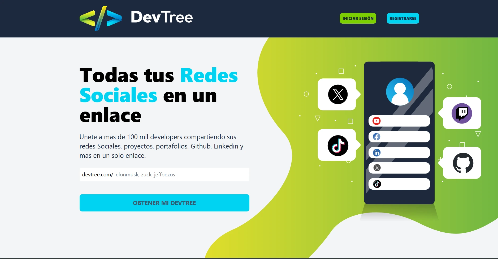
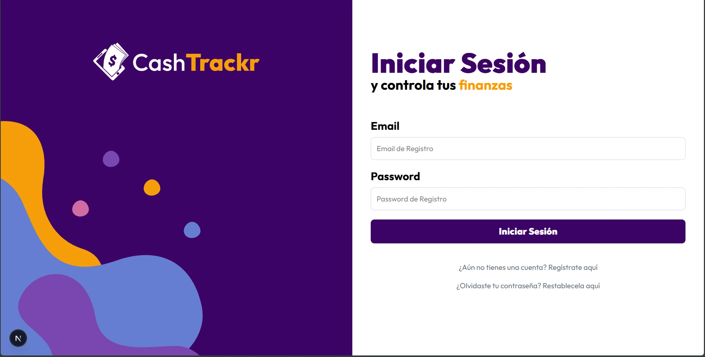
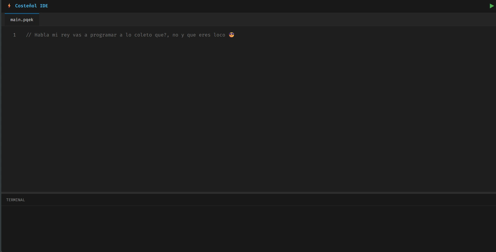
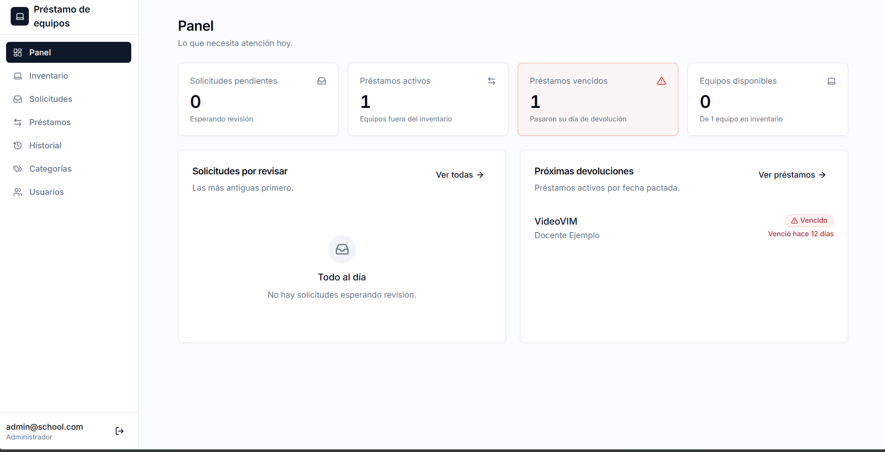

# HeymerDev · Portafolio

Portafolio personal de **Heymer Meza**: Ingeniero de Sistemas en formación y desarrollador Full-Stack. Es una sola página con presentación, trayectoria, educación, skills, proyectos y contacto.

[GitHub](https://github.com/HeymerDev) · [LinkedIn](https://www.linkedin.com/in/heymer/) · [Correo](mailto:heymermeza11@gmail.com) · [TikTok](https://www.tiktok.com/@heymerm)

## Índice

- [Sobre mí](#sobre-mí)
- [Proyectos](#proyectos)
- [Experiencia](#experiencia)
- [Educación](#educación)
- [Skills](#skills)
- [Desarrollo](#desarrollo)
  - [Stack](#stack)
  - [Requisitos y comandos](#requisitos-y-comandos)
  - [Estructura](#estructura)
  - [Editar el contenido](#editar-el-contenido)
  - [Diseño](#diseño)
  - [Deploy](#deploy)

---

## Sobre mí

Estudio Ingeniería de Sistemas y dedico gran parte de mi tiempo a desarrollar aplicaciones web y soluciones empresariales. He trabajado en proyectos que van desde sistemas de inventario y facturación hasta plataformas de monitoreo en tiempo real y aplicaciones para evaluaciones en línea.

Mi objetivo es construir una empresa de software enfocada en ayudar a pequeñas y medianas empresas a digitalizar sus procesos.

---

## Proyectos

### Dev-Tree



Proyecto basado en Linktree para desarrolladores, donde puedes compartir tus redes sociales y tu perfil de GitHub de una manera rápida y sencilla.

**Tecnologías:** `React` `NodeJS` `Express` `MongoDB` `TailwindCSS`

**Demo:** [dev-tree-heymerdev.netlify.app](https://dev-tree-heymerdev.netlify.app/) · **Código:** [Frontend](https://github.com/HeymerDev/dev-tree-frontend) · [Backend](https://github.com/HeymerDev/dev-tree-backend)

### CashTracker



Seguimiento de gastos personales: registra tus ingresos y gastos y visualiza tus finanzas de una manera rápida y sencilla.

**Tecnologías:** `NextJS` `NodeJS` `Express` `PostgreSQL` `Sequelize` `TailwindCSS`

**Demo:** [cash-tracker-frontend-eight.vercel.app](https://cash-tracker-frontend-eight.vercel.app/) · **Código:** [Frontend](https://github.com/HeymerDev/cash-tracker-frontend) · [Backend](https://github.com/HeymerDev/cash-tracker-backend)

### Costeñol



Mini compilador de Costeñol, un lenguaje de programación basado en español, con una sintaxis sencilla y fácil de aprender.

**Tecnologías:** `JavaScript` `NodeJS`

**Demo:** [compilatorjs.netlify.app](https://compilatorjs.netlify.app/) · **Código:** [compilator-js](https://github.com/HeymerDev/compilator-js)

### Gestor de préstamos de equipos tecnológicos



Sistema para gestionar los préstamos de equipos tecnológicos en una institución.

**Tecnologías:** `NextJS` `NodeJS` `Express` `PostgreSQL` `TailwindCSS`

**Demo:** [equipment-loan-management.vercel.app](https://equipment-loan-management.vercel.app/) · **Código:** [equipment-loan-management](https://github.com/HeymerDev/equipment-loan-management)

---

## Experiencia

| Empresa                      | Rol                          | Periodo                    |
| :--------------------------- | :--------------------------- | :------------------------- |
| Extituto de Política Abierta | Desarrollador Web FullStack  | Marzo 2025 - Octubre 2025  |

## Educación

| Institución                                      | Título                                | Periodo                                     |
| :----------------------------------------------- | :------------------------------------ | :------------------------------------------ |
| Corporación Universitaria Latinoamericana        | Ingeniería de Sistemas y Computación  | Agosto 2022 - Actualidad (9no semestre)     |
| Inst. Edu. Nuestra Señora del Rosario de Pitalito | Bachiller Académico                   | Enero 2016 - Diciembre 2021                 |

## Skills


---

## Desarrollo

### Stack

- [Astro 6](https://astro.build): sitio de una sola página (`src/pages/index.astro`)
- [Tailwind CSS 4](https://tailwindcss.com), integrado con `@tailwindcss/vite`
- TypeScript, con tipos para todos los datos en `src/types.ts`
- Deploy en [Netlify](https://www.netlify.com) con `@astrojs/netlify`
- Fuentes: Inter e íconos de [Material Symbols](https://fonts.google.com/icons) (Google Fonts)

### Requisitos y comandos

Necesitas Node.js `>= 22.12.0` y [pnpm](https://pnpm.io). Todos los comandos se ejecutan desde la raíz del proyecto:

| Comando        | Acción                                               |
| :------------- | :--------------------------------------------------- |
| `pnpm install` | Instala las dependencias                             |
| `pnpm dev`     | Inicia el servidor de desarrollo en `localhost:4321` |
| `pnpm build`   | Genera el build de producción                        |
| `pnpm preview` | Sirve el build localmente para revisarlo             |

### Estructura

```text
/
├── public/
│   ├── jobs/           # Logos de las empresas (experiencia)
│   ├── projects/       # Capturas de los proyectos (.webp)
│   ├── me.webp         # Foto del hero
│   └── Heymer Meza Gutierrez CV-PDF.pdf   # CV que descarga el navbar
├── src/
│   ├── components/
│   │   ├── cards/      # Piezas reutilizables
│   │   └── views/      # Secciones de la página
│   ├── data/           # Contenido del portafolio
│   ├── layouts/
│   │   └── Layout.astro
│   ├── pages/
│   │   └── index.astro # Arma la página y las animaciones de entrada
│   ├── styles/
│   │   └── global.css  # Tokens de diseño y estilos globales
│   └── types.ts        # Interfaces de los datos
└── astro.config.mjs
```

Cada sección de la página es un componente en `src/components/views/` que lee su lista de `src/data/` y la pinta con una card de `src/components/cards/`:

| Sección (view)         | `id` del ancla  | Datos                     | Card                              |
| :--------------------- | :-------------- | :------------------------ | :-------------------------------- |
| `Navbar.astro`         | —               | `navLinks.ts`             | —                                 |
| `Hero.astro`           | `#hero`         | texto en el componente    | —                                 |
| `About.astro`          | —               | texto en el componente    | —                                 |
| `WorkExperience.astro` | `#experiencia`  | `jobs.ts`                 | `CardExperience.astro`            |
| `Education.astro`      | —               | `educations.ts`           | `CardEducation.astro`             |
| `Skills.astro`         | —               | `skills.ts`               | `CardSkill.astro`                 |
| `Projects.astro`       | `#proyectos`    | `projects.ts`             | `CardProject.astro` + `CardTechnology.astro` |
| `SocialNetworks.astro` | `#contacto`     | `SocialNetworks.ts`       | `CardSocialNetwork.astro`         |
| `Footer.astro`         | —               | `SocialNetworks.ts`       | —                                 |

### Editar el contenido

Todo el contenido de las listas vive en `src/data/`, tipado con las interfaces de `src/types.ts`. Para agregar o cambiar algo no hace falta tocar los componentes.

#### Proyectos (`src/data/projects.ts`)

1. Guarda la captura en `public/projects/`, de preferencia en `.webp`.
2. Agrega un objeto al arreglo:

```ts
{
  name: "Nombre del proyecto",
  description: "Qué hace el proyecto, en una o dos frases.",
  link: "https://mi-proyecto.vercel.app/", // "" si todavía no está publicado
  repositories: [
    "https://github.com/HeymerDev/mi-proyecto-frontend",
    "https://github.com/HeymerDev/mi-proyecto-backend",
  ],
  image: "/projects/mi-proyecto.webp",
  technologies: ["NextJS", "NodeJS", "PostgreSQL"],
},
```

| Campo          | Tipo       | En la card                                                                                           |
| :------------- | :--------- | :--------------------------------------------------------------------------------------------------- |
| `name`         | `string`   | Título                                                                                               |
| `description`  | `string`   | Texto debajo del título, cortado a 3 líneas                                                          |
| `link`         | `string`   | Botón "Vista previa". Si está vacío, en su lugar aparece "En desarrollo"                             |
| `repositories` | `string[]` | Un enlace por repo. El nombre sale de la URL: **Frontend** si contiene `frontend`, **Backend** si contiene `backend` y **Código** en otro caso |
| `image`        | `string`   | Ruta dentro de `public/`. No se ve de entrada: aparece al hacer hover, de desenfocada a nítida       |
| `technologies` | `string[]` | Badges negros con letra blanca (`CardTechnology.astro`)                                              |

#### Experiencia (`src/data/jobs.ts`)

Guarda el logo de la empresa en `public/jobs/` y agrega:

```ts
{
  image: "/jobs/mi-empresa.png",
  jobNmae: "Nombre de la empresa",
  jobDescription: "Desarrollador Web FullStack",
  workAges: "Enero 2026 - Actualidad",
},
```

| Campo            | Tipo     | En la página                         |
| :--------------- | :------- | :----------------------------------- |
| `image`          | `string` | Logo circular a la izquierda         |
| `jobNmae`        | `string` | Nombre de la empresa (título)        |
| `jobDescription` | `string` | Rol o cargo, debajo del nombre       |
| `workAges`       | `string` | Periodo, alineado a la derecha       |

> El campo se llama `jobNmae` (con el error de escritura) en `src/types.ts` y en los datos. Si se corrige a `jobName`, hay que cambiarlo en el tipo, en `jobs.ts` y en `WorkExperience.astro`.

#### Educación (`src/data/educations.ts`)

```ts
{
  schoolName: "Nombre de la institución",
  degree: "Título obtenido o en curso",
  schoolAges: "Agosto 2022 - Actualidad",
},
```

#### Skills (`src/data/skills.ts`)

```ts
{ id: 14, name: "Docker" },
```

`id` tiene que ser único: usa el siguiente número de la lista. Cada skill se muestra como un badge claro (`CardSkill.astro`) en el orden del arreglo.

#### Redes sociales (`src/data/SocialNetworks.ts`)

```ts
{
  name: "GitHub",
  link: "https://github.com/HeymerDev",
  icon: "code",
},
```

`icon` es el nombre de un ícono de [Material Symbols](https://fonts.google.com/icons). Estas redes aparecen como botones redondos en la sección de contacto y como enlaces en el footer.

#### Navbar (`src/data/navLinks.ts`)

```ts
{ path: "#proyectos", name: "Proyectos" },
```

`path` es el `id` de la sección a la que salta. Si agregas una sección nueva al menú, ponle un `id` en su `<section>` y agrégala aquí.

Los textos fijos, como el saludo del hero y "Sobre mí", están directamente en su componente dentro de `src/components/views/`.

### Diseño

Los tokens de diseño están en el bloque `@theme` de `src/styles/global.css` y se usan como clases de Tailwind (`bg-primary`, `text-muted-foreground`, `font-headline-md`, etc.). La paleta es en blanco y negro: `primary` es `#000000` y `on-primary` es `#ffffff`.

- **Ancho del contenido**: lo controla `--spacing-container-max`, que hoy está en `830px`. La utilidad `container-page` la usan el navbar, el `main` y el footer para quedar alineados al mismo margen (`--spacing-margin-page`). Para cambiar el ancho de toda la web basta con cambiar ese token.
- **Badges**: `CardSkill` (fondo claro) se usa en la sección de skills y `CardTechnology` (fondo negro, letra blanca) en las cards de proyectos.
- **Grilla de proyectos**: la clase `.bento-grid` muestra 2 columnas y pasa a 1 columna en pantallas de menos de 640px.
- **Scroll**: es suave al tocar los enlaces del navbar y respeta `prefers-reduced-motion`. `scroll-padding-top` evita que el navbar fijo tape el título de la sección.
- **Animaciones de entrada**: el script de `src/pages/index.astro` hace aparecer cada `<section>` con un fade al entrar en pantalla y le agrega sombra al navbar al hacer scroll.

### Deploy

El proyecto usa el adaptador `@astrojs/netlify`. Netlify ejecuta `pnpm build` y publica el resultado. La configuración está en `astro.config.mjs`.
